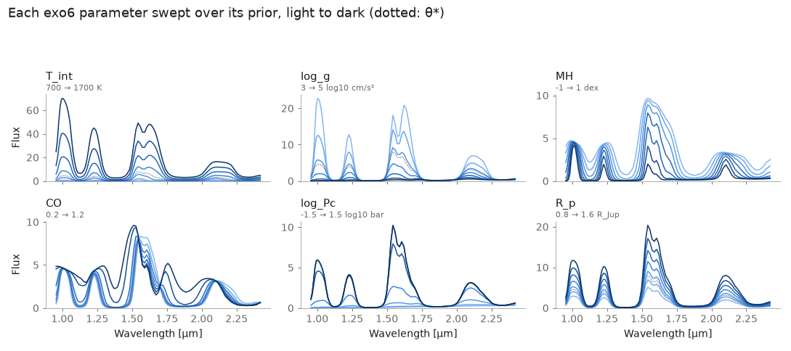
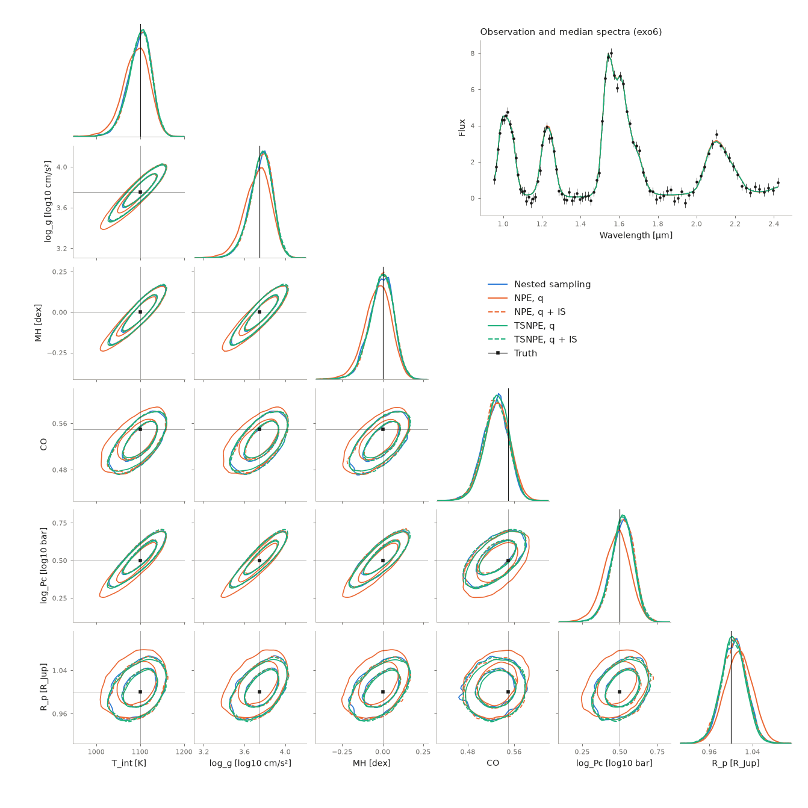
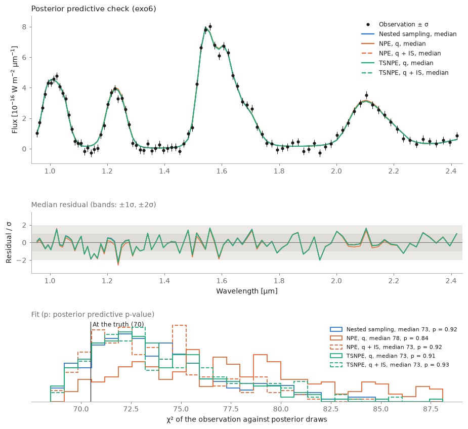

# exomini

Point a telescope at a made-up planet, get a noisy spectrum, and work out what the planet is made of.

exomini does simulation-based inference on toy exoplanet emission spectra. It provides three forward models (6, 30
and 50 parameters) with exact likelihoods, and three inference methods:
- **NPE**: amortised neural posterior estimation.
- **TSNPE**: truncated sequential NPE.
- **Nested sampling**: classical sampling with the exact likelihood.

> **Disclaimer.** This codebase was entirely vibe-coded with an AI assistant. The physics is schematic and the
> code is not validated on real data: do not use it for serious exoplanet science. Its purpose is to show how
> to do simulation-based inference (NPE, TSNPE) and nested sampling on a problem shaped like an atmospheric
> retrieval.

## Install

```bash
pip install -e ".[test]"
pytest            # ~2 min on CPU
```

The code runs on CPU and uses a GPU when there is one. Recent PyTorch wheels dropped older GPUs (GTX 10xx, for
example): there, install a CUDA 12.6 build first,
`pip install torch --index-url https://download.pytorch.org/whl/cu126`.

`nested.py` runs one process per CPU, each with its own copy of the model: allow about 0.5 GB of memory per CPU.

## Quick start

```bash
python npe.py     --model exo6   # amortised NPE
python tsnpe.py   --model exo6   # truncated sequential NPE
python nested.py  --model exo6   # nested sampling
python compare.py --model exo6   # corner.png, ppc.png, table.md
```

Results go to `runs/exo6/`.

## Meet the planets

A model maps parameters θ to the spectrum a telescope would see:

    θ  →  atmosphere (temperature at each altitude, gas abundances, clouds)  →  emitted light  →  binned, plus noise

The three models are the same kind of planet at increasing levels of detail.

**`exo6`** has 6 parameters and a few physical assumptions. One internal temperature sets the whole
temperature profile. The overall metallicity and the carbon-to-oxygen ratio set the abundances of H2O, CH4 and
CO. The remaining parameters are a cloud-top pressure, the surface gravity and the radius. The parameters are
well constrained, so this model is quick to explore.



Each panel sweeps one parameter over its prior, the others fixed at θ\*. Draw it for any model with
`python simulate.py --model exo30 --plot parameters.png`.

**`exo30`** has 30 parameters and few assumptions, like a "free" retrieval:
- Temperature: free at 10 altitudes.
- Gases: 15 species, each abundance free.
- Cloud: one deck with free height, thickness and colour.
- Planet: gravity and radius.

Many parameters are barely constrained by the data, as in practice.

**`exo50`** has 50 parameters, modelled on retrievals of brown dwarfs with petitRADTRANS:
- Temperature: its slope with altitude, free at 10 altitudes.
- Main gases: from metallicity and C/O, with mixing frozen above a free pressure, plus the 13C isotope.
- Trace gases: 20 species, each abundance free.
- Clouds: silicate and iron, each with a free base, amount, thickness and particle size. They cover a free
  fraction of the disc, and there is a haze.
- Instrument: a calibration offset between the two detectors.

About half the parameters are constrained.

| | `exo6` | `exo30` | `exo50` |
|---|---|---|---|
| Parameters | 6 | 30 | 50 |
| Wavelengths | 0.95–2.45 μm | 0.85–4.95 μm | 0.85–4.95 μm |
| Spectral bins (R ≈ 100) | 94 | 176 | 176 |

**Every parameter, with its meaning, unit, prior range and benchmark value θ\*, is listed in
[PARAMETERS.md](PARAMETERS.md).** For a single model, run `python simulate.py --model exo50 --describe`.

**Priors** are uniform between a lower and an upper bound. They are set in the `PARAMETERS` table at the top of
`exomini/exo6.py`, `exo30.py` and `exo50.py`, one row per parameter. To change a prior, edit its bounds:

```python
# name, prior lower, prior upper, benchmark θ*, unit, description
("log_g", 3.0, 5.0, 3.75, "log10 cm/s²", "surface gravity"),
```

Then run `python tools/make_parameters_md.py` to update PARAMETERS.md (a test checks it is up to date).

**Noise** is Gaussian, with the same σ in every bin: S/N ≈ 30 at the brightest point of the benchmark spectrum.

## Data

```python
from exomini import Model

m = Model("exo30")
theta = m.sample_prior(1000, seed=0)
x = m.simulate(theta, seed=0)    # noisy spectra; m.flux(theta) gives them noise-free
theta, x = m.test_pairs()        # 8 fixed pairs; pair 0 is the benchmark
m.log_likelihood(theta, x)       # exact
```

```bash
python simulate.py --model exo50 --describe                  # parameter table
python simulate.py --model exo6 --n 10000 --out data.npz     # pairs from the prior
python simulate.py --model exo6 --theta 1300 4 0.5 0.8 0 1.2 --out obs.npz
python simulate.py --model exo6 --plot parameters.png        # what each parameter does
```

By default every method conditions on test pair 0. Choose another with `--obs 3`, or your own with
`--obs obs.npz`.

## Methods

- **`npe.py`**: trains q(θ | x) once on prior simulations, then samples q(θ | x_obs).
- **`tsnpe.py`**: works in rounds. Each round simulates from the prior restricted to where the last
  q(θ | x_obs) puts 1 − 10⁻⁴ of its mass, then retrains on all the simulations so far.
- **`nested.py`**: dynesty (random slice sampling) with the exact likelihood. It gives log Z directly, but
  each likelihood evaluation is one simulation.

NPE and TSNPE finish with **importance sampling**: q's draws are reweighted by p(x | θ) p(θ) / q(θ | x).
- **ESS** close to the number of draws means q is accurate; an ESS of a few means q is wrong.
- **log Z** is the evidence.

The options shared by all scripts are `--model`, `--obs`, `--seed`, `--out` and `--name`. See `--help`.

## Comparing runs

`compare.py` writes three files to `runs/<model>/`:
- **`corner.png`**: marginals, one colour per run. For NPE and TSNPE, q is solid and q + IS is dashed.
- **`ppc.png`**: spectra of posterior draws, and the χ² of x_obs. A good posterior gives χ² ≈ the number of bins.
- **`table.md`**: simulations used, ESS, log Z and median χ². It also compares the marginals with those of one
  run (`--against`, default nested sampling): the mean shift (in that run's standard deviations) and the width
  ratio (1 = same width).

No method is ground truth, nested sampling included: each has its own error. Agreement between methods that
work differently is the evidence.

## Example: exo6

Each method run on the benchmark observation (test pair 0) with its default settings.





| Posterior | Simulations | ESS | log Z | Median χ² | Mean shift vs nested sampling (σ) | Width vs nested sampling |
|---|---|---|---|---|---|---|
| Nested sampling | 483,205 | – | -12.11 ± 0.35 | 73 | – | – |
| NPE, q | 100,000 | – | – | 78 | 0.31 | 1.14 |
| NPE, q + IS | 100,000 | 3,523 | -11.85 | 73 | 0.03 | 0.99 |
| TSNPE, q | 100,000 | – | – | 73 | 0.06 | 0.99 |
| TSNPE, q + IS | 100,000 | 15,867 | -11.86 | 73 | 0.02 | 1.00 |

- **All three agree.** The two log Z estimates from importance sampling fall within nested sampling's error bar.
- **NPE's q is broader than the rest** (1.14 times nested sampling's width). Importance sampling brings it in line.
- **TSNPE's q is already close.** For the same 100k simulations, its ESS is 4.5 times NPE's.

To reproduce (GPU optional):

```bash
./reproduce.sh    # npe.py, tsnpe.py, nested.py, compare.py on exo6, then copies the figures to results/exo6/
```

On our cluster:

| Method | Hardware | Time |
|---|---|---|
| NPE | 1 GPU | 16 min |
| TSNPE | 1 GPU | 46 min |
| Nested sampling | 32 CPUs | 4 min |

The methods are independent, so they can run in parallel. GPU training is not bit-for-bit reproducible: expect
small differences.

## Things to try

- **Beat TSNPE.** Match its ESS on exo6 with fewer simulations (`--rounds`, `--sims`).
- **Leave the prior.** Make an observation outside the prior box with `simulate.py --theta`, condition NPE on it
  with `--obs`, and watch the ESS.
- **Go big.** Run the three methods on exo50. Which parameters does the spectrum pin down, and which does it
  barely touch?
- **Trust no one.** Rerun nested sampling with a different `--seed` or more `--nlive`. How much does log Z move?

## Layout

| | |
|---|---|
| `exomini/exo6.py`, `exo30.py`, `exo50.py` | models: `PARAMETERS`, grids, batched `flux(θ)` in torch |
| `exomini/physics.py` | radiative transfer, opacity bands, binning |
| `exomini/model.py` | `Model`: prior, simulation, likelihood, test pairs |
| `exomini/inference.py` | `NPE`, `fit`, `importance_sampling`, `truncated_prior` |
| `exomini/runs.py` | run folders, shared script options |
| `exomini/data/` | the test pairs |
| `*.py` | the scripts; `reproduce.sh` reruns the exo6 example |
| `results/` | the exo6 example |
| `tests/` | models, inference, scripts end to end |
| `tools/` | regenerate `PARAMETERS.md` and the test pairs after changing a model |

## License

BSD 3-Clause, see [LICENSE](LICENSE).
